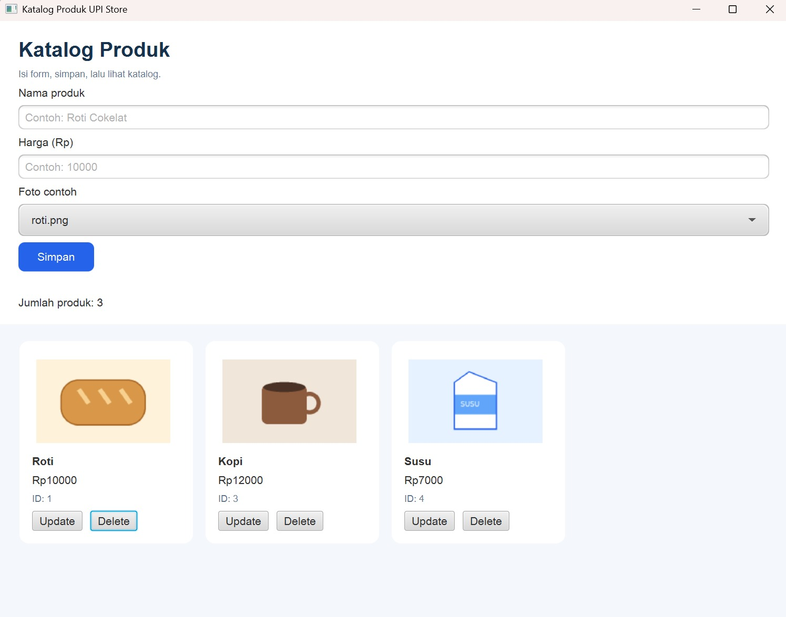
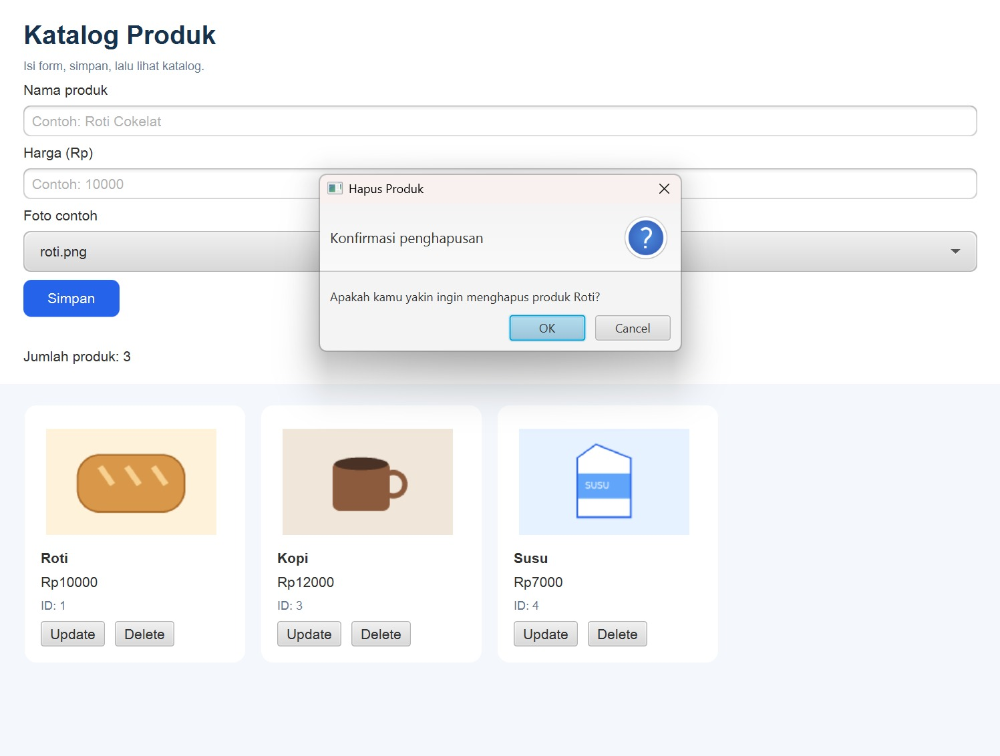
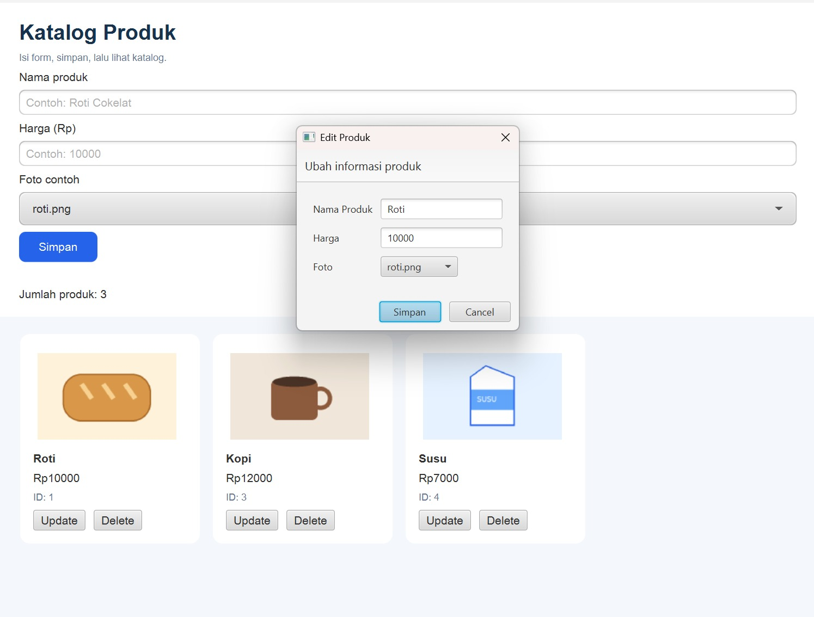

#  Katalog Produk 

Aplikasi desktop sederhana untuk mengelola dan menampilkan katalog produk menggunakan **Java, JavaFX, Maven, dan SQLite**.

Project ini dikembangkan sebagai implementasi pemrograman Java dengan konsep pengelolaan data produk melalui antarmuka grafis (GUI).

##  Deskripsi Project

Katalog Produk merupakan aplikasi yang memungkinkan pengguna untuk menyimpan dan melihat informasi produk berupa nama produk, harga, dan foto produk.

Aplikasi menggunakan JavaFX sebagai framework antarmuka pengguna serta SQLite sebagai database untuk menyimpan data produk secara lokal.

##  Fitur Aplikasi

- **Tambah Produk (Create)** – Menambahkan produk baru melalui form input.
- **Tampilkan Produk (Read)** – Menampilkan daftar produk dalam bentuk kartu katalog.
- **Validasi Input** – Memastikan nama produk terisi, harga berupa angka positif, dan foto produk dipilih.
- **Penyimpanan Database** – Menyimpan data produk menggunakan SQLite.
- **Update Produk (Update)** – Pengembangan fitur untuk mengubah informasi produk.
- **Hapus Produk (Delete)** – Pengembangan fitur untuk menghapus produk dari katalog.

##  Teknologi yang Digunakan

| Teknologi | Keterangan |
|---|---|
| Java 17 | Bahasa pemrograman |
| JavaFX 21 | Framework GUI |
| Maven | Dependency management |
| SQLite | Database lokal |
| SQLite JDBC 3.49.1.0 | Koneksi Java dengan SQLite |
| FXML | Struktur antarmuka aplikasi |
| CSS | Styling tampilan aplikasi |

##  Struktur Project

```text
KatalogProduk/
│
├── data/
│
├── src/
│   └── main/
│       ├── java/
│       │   ├── controller/
│       │   │   └── KatalogController.java
│       │   │
│       │   ├── data/
│       │   │   └── ProdukRepository.java
│       │   │
│       │   ├── db/
│       │   │   └── Database.java
│       │   │
│       │   ├── main/
│       │   │   └── MainApp.java
│       │   │
│       │   └── model/
│       │       └── Produk.java
│       │
│       └── resources/
│           ├── image/
│           │   ├── kopi.png
│           │   ├── roti.png
│           │   └── susu.png
│           │
│           └── view/
│               ├── katalog.fxml
│               └── styles/
│                   └── app.css
│
└── pom.xml
```

##  Persyaratan Sistem

Sebelum menjalankan aplikasi, pastikan perangkat telah memiliki:

- JDK 17 atau lebih baru.
- Apache Maven.
- IDE seperti NetBeans atau IntelliJ IDEA.
- Koneksi internet saat pertama kali mengunduh dependency Maven.

##  Cara Menjalankan Aplikasi

**1. Clone repository**

```bash
git clone https://github.com/arinyrahmawati/katalog_produk.git
```

**2. Masuk ke direktori project**

```bash
cd KatalogProduk
```

**3. Jalankan aplikasi menggunakan Maven**

```bash
mvn clean javafx:run
```

**4. Aplikasi berhasil dijalankan**

Setelah berhasil, jendela aplikasi Katalog Produk UPI Store akan ditampilkan.

##  Database

Aplikasi menggunakan SQLite sebagai database lokal.

Database akan dibuat secara otomatis ketika aplikasi pertama kali dijalankan.

Nama database:

```text
katalog.db
```

Lokasi database:

```text
data/katalog.db
```

Struktur tabel `produk`:

| Kolom | Tipe Data | Keterangan |
|---|---|---|
| id | INTEGER | Primary Key |
| nama | TEXT | Nama produk |
| harga | INTEGER | Harga produk |
| foto | TEXT | Nama file gambar |

##  Tampilan Aplikasi

### 1. Halaman Katalog Produk



### 2. Form Tambah Produk



### 3. Form Update Produk



##  Pengembang

**Katalog Produk UPI Store**

Dikembangkan sebagai project pembelajaran pemrograman Java menggunakan JavaFX dan SQLite.

---

